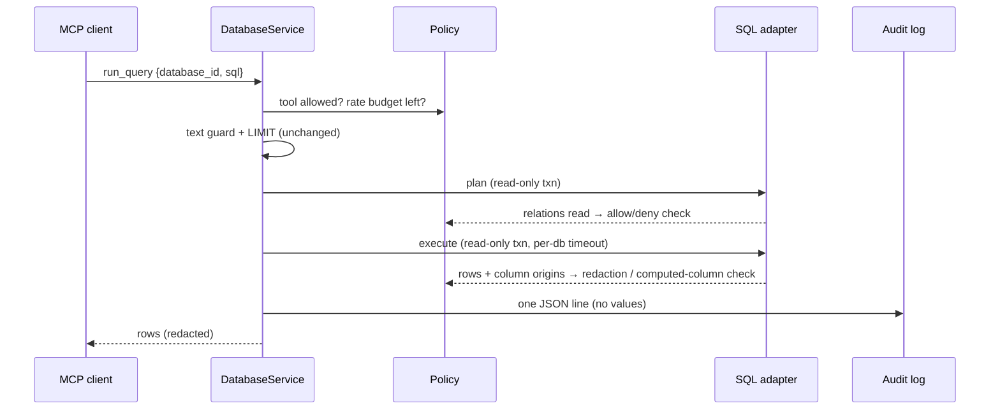

# Governance: a design proposal

**Status: proposal, not implemented.** This document describes the controls
that would turn `mcp-multi-db` from a read-only query server into a *governed*
gateway: the agent sees only what its policy allows, sensitive values never
reach the model, and every call leaves an audit record. Nothing here changes
today's behaviour; every control is opt-in.

## Why

Read-only answers one question: *can the agent change data?* It does not
answer the questions a security reviewer asks next:

1. **What can it read?** Today: every table the database user can see.
2. **Can it see personal data?** Today: yes, if the user can.
3. **Can I switch a capability off for one database?** Today: only by
   removing the database.
4. **What did it actually run?** Today: nothing is recorded.
5. **What stops a loop of a thousand queries?** Today: the row cap and the
   30s timeout, per query, with no budget across queries.

The operator recommendations in [SECURITY.md](../SECURITY.md) (a `SELECT`-only
user, a replica) remain the strongest control. This proposal adds the controls
a database grant cannot express, and enforces each one **below the prompt**,
in code the model cannot talk its way past.

## Principles

- **Opt-in, backwards compatible.** A config with no `policy` and no `audit`
  behaves exactly as v1.0.2. Ships as a minor release.
- **Ask the engine, not the text.** Where a control depends on *what a query
  touches*, the answer comes from the database's own plan or result metadata,
  not from parsing SQL. The text guard stays, as the first of several layers.
- **Fail closed.** If a control cannot determine what a query touches, the
  query is refused, with a reason the agent can act on.
- **Every refusal is audited**, with the rule that refused it.

## Phase 1: per-database policy and an audit log (v1.1)

### Config

```json
{
  "audit": { "path": "./audit.jsonl", "sql": "full" },
  "databases": [
    {
      "id": "crm",
      "type": "postgres",
      "connectionString": "postgres://readonly@replica/crm",
      "policy": {
        "tools": ["list_tables", "describe_table", "run_query"],
        "tables": { "allow": ["public.accounts", "public.deals"] },
        "columns": { "redact": ["public.accounts.email", "public.accounts.phone"] },
        "maxRows": 200,
        "timeoutMs": 10000,
        "rateLimit": { "queriesPerMinute": 30 }
      }
    }
  ]
}
```

### 1. Tool scope — "revoke a capability"

`policy.tools` lists the tools exposed for that database. Leaving out
`run_query` makes a database schema-only: the agent can learn its shape but
cannot read rows. `list_databases` reports each database's allowed tools, so
the agent does not waste a call discovering a refusal.

*Enforced in:* `DatabaseService`, before any adapter call.

### 2. Table allow-list and deny-list — enforced from the query plan

`policy.tables.allow` (or `deny`) names the relations a query may read. The
check runs on the **plan**, not the SQL text, so aliases, CTEs, subqueries and
quoting cannot hide a table:

| Engine | How the relations a query reads are found |
|--------|-------------------------------------------|
| PostgreSQL | `EXPLAIN (FORMAT JSON)` — every `Relation Name` + `Schema` in the plan tree |
| MySQL | `EXPLAIN FORMAT=JSON` — every `table_name`. MySQL reports the **alias** there, so a name that is not a real table in `information_schema.tables` is refused (fail closed: aliased queries over governed tables must use the table name) |
| SQLite | `EXPLAIN` bytecode — each `OpenRead` root page, mapped through `sqlite_master.rootpage` to its `tbl_name` (so an index read counts as its table) |

The plan runs inside the same read-only transaction as the query. If any
relation in the plan is outside the policy, or the plan cannot be read, the
query is refused before it executes.

**Stated limits.** Views are expanded to their base tables in PostgreSQL and
SQLite plans, so an allow-list names base tables (or the operator grants the
view to a role and relies on the grant). A function that reads another table
inside its body does not appear in a plan; the `SELECT`-only database user is
what bounds that case, and the docs will say so.

### 3. Column redaction — alias-proof, from result metadata

`policy.columns.redact` lists `schema.table.column` (or `table.column` for
SQLite) whose values are replaced with `"[redacted]"` before the result leaves
the server. Redaction is keyed on each result column's **origin**, which every
driver reports, so `SELECT email AS e` is still redacted:

| Engine | Origin of a result column |
|--------|---------------------------|
| PostgreSQL | `FieldDef.tableID` + `columnID`, resolved via `pg_attribute` (cached) |
| MySQL | `FieldPacket.orgTable` + `orgName` |
| SQLite | `Statement.columns()` → `table` + `column` |

**The gap, and how it closes.** A computed column (`lower(email)`,
`email || ''`) has no origin. So when a result contains a column with no
origin **and** the plan reads a table holding a redacted column, the query is
refused with: *"computed columns over a table with redacted columns are not
allowed; select the column directly"*. That over-refuses some harmless
queries, which is the right side to err on.

### 4. Budgets

- `maxRows` and `timeoutMs` override the global 100/1000 rows and 30s timeout,
  per database, and can only make them stricter.
- `rateLimit.queriesPerMinute` caps `run_query` calls per database with a
  token bucket. A refusal says when the next query is allowed.

### 5. Audit log

When `audit.path` is set, every tool call appends one JSON line:

```json
{"ts":"2026-11-02T10:14:03.512Z","tool":"run_query","database_id":"crm",
 "sql":"SELECT name, email FROM public.accounts LIMIT 200",
 "outcome":"ok","rowCount":200,"truncated":true,
 "tables":["public.accounts"],"redacted":["public.accounts.email"],"ms":41}
```

- `outcome` is `ok`, `refused` (with `rule` and `reason`) or `error`.
- **Result values are never logged.** `audit.sql: "hash"` records a SHA-256 of
  the SQL instead of the text, for databases where the query itself is
  sensitive.
- Append-only, one line per call, written before the response is returned. A
  write failure is reported on stderr and does not block the query (an audit
  log that can take the server down becomes a denial-of-service lever); an
  `audit.required: true` flag inverts that for operators who want fail-closed.

### Where it sits



### Testing

Each control gets tests against SQLite in `test/` (the existing runner, no new
dependencies), including the bypasses it exists to stop: aliased redacted
columns, a CTE over a denied table, a computed column over a redacted one, and
an unreadable plan failing closed. PostgreSQL and MySQL paths get the same
cases in an integration job against service containers in CI.

## Phase 2: an HTTP transport with scoped, revocable keys (v1.2)

Today the server speaks stdio, so whoever can start the process holds all of
its access. A **Streamable HTTP** transport (supported by the MCP SDK) would
let one deployed gateway serve several clients, each with its own key:

- Keys live in a file as hashes, each scoped to databases and tools.
- **Revoking is deleting a line**; the file is re-read on change.
- The audit log gains a `client` field, so every call is attributable.

This is where "one governed endpoint, a scoped key per agent" comes from. It
is a larger change than Phase 1 and is worth doing once Phase 1 is in use.

## Explicitly not proposed: write access

Some data gateways let agents write back through named, per-action
permissions. That is a sound pattern, but it would end this project's core
guarantee, *read-only, enforced at the connection*, which is why people choose
it. If write actions are ever wanted, they belong in a separate server with
its own name and its own security model, not behind a flag here.
